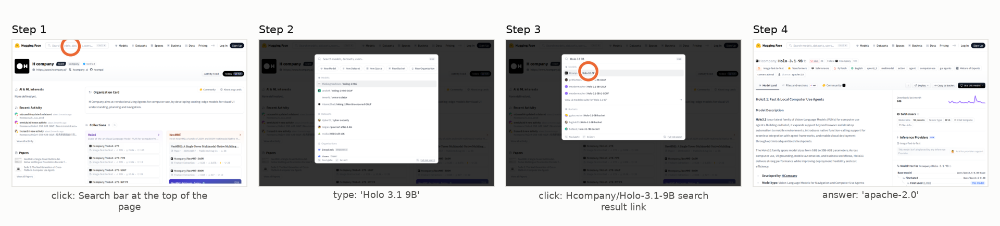

# holo-playground

[](https://github.com/noech373/holo-playground/actions/workflows/ci.yml)

Experiments with [Holo 3.1](https://huggingface.co/collections/Hcompany/holo31), H Company's computer-use model, on a laptop CPU with [llama.cpp](https://github.com/ggml-org/llama.cpp). Two questions:

1. **Grounding:** how much screen resolution does the model need to click the right element, and what does it cost?
2. **Agent:** can it complete a web task end to end, step after step, and where does the time go?

The agent is written from scratch (Playwright, Pydantic, no agent framework) and runs either locally or on H's hosted API. Every action and its duration are recorded; with llama.cpp, so are the tokens computed and reused at each step.

**Detailed analyses:** [grounding](docs/grounding_analysis.md) and [web agent](docs/agent_analysis.md).

## Results

| experiment | model and machine | result |
|---|---|---|
| grounding, 4 targets | 9B, 512 image tokens, laptop CPU | 4/4 hits, 50 s per click (187 s at full resolution) |
| agent, 1 task | 9B, 512 image tokens, laptop CPU | 2/2 trials, 4 steps, ~8.7 min each |
| agent, same task | `holo3-1-35b-a3b`, H's API | 3/3 trials, 4–6 steps, 16–47 s each |

- **Below ~512 image tokens, grounding does not degrade gracefully: it collapses.**
- **On a CPU, memory management drives the agent's cost.** A step takes 80–100 s when the KV cache is re-used, and ~190–205 s when dropping an old screenshot breaks it.
- **The evaluator can be wrong too.** The first hosted trial was scored a failure although the agent's answer was right.

These are small samples: they show that the pipeline works and where the time goes, not success rates.

## Grounding: accuracy vs. image budget

One 1897×963 screenshot, 4 targets, temperature 0. The sweep caps the number of tokens the image is encoded into (`--image-max-tokens`). A *hit* is a click inside the target's box.


| `--image-max-tokens` | 4B hits | 4B latency | 9B hits | 9B latency |
|---|---|---|---|---|
| default (4096) | 4/4 | 131 s | 4/4 | 187 s |
| 1024 | 4/4 | 66 s | 3/4 | 94 s |
| 512 | 3/4 | 32 s | 4/4 | 50 s |
| 256 | 2/4 | 18 s | 2/4 | 31 s |
| 128 | 0/4 | 12 s | 1/4 | 21 s |

- **Image tokens drive the latency:** the prefill is 80–98 % of each request.
- **Best trade-off here: 9B at 512 tokens.** It is faster than the 4B at 1024 tokens (50 s vs. 66 s) for a similar or better accuracy.
- **The 9B degrades more gracefully:** at 128 tokens its worst click is 53 px from the target center, against 570 px for the 4B.

**Limits:** 4 targets on 1 screenshot is a smoke test, not a benchmark, and some misses are likely noise. [Full analysis](docs/grounding_analysis.md).

## Agent: a web task from scratch

```
          ┌──────────────── one step ────────────────┐
task ──►  screenshot ──► Holo model ──► JSON step ──► Playwright ──► next screenshot ...
          (1280×800)     (llama-server  {note, thought,  (click / type /
                          or H's API)    tool_call}       scroll / answer)
```

The task: start on `huggingface.co/Hcompany`, *"Open the page of the Holo 3.1 9B model and give its license."* Here is a local trial, with the orange rings where the model clicked:



| | steps | end to end | waiting for the model |
|---|---|---|---|
| local 9B, trial of 2026-11-23 16:12 | 4 | 520 s | 508 s |
| H's API, trial 1 | 4 | 23 s | 10 s |
| H's API, trial 2 | 4 | 16 s | 7 s |
| H's API, trial 3 | 6 | 47 s | 36 s |

- **The KV cache works across steps, images included**, until `keep_last=3` drops a screenshot: from step 4, most of the prompt is recomputed.
- **With fast inference, the browser matters:** 8–13 s per hosted trial are spent outside model calls.
- **The path can vary:** one hosted trial scrolled to the model instead of searching for it.

**Limits:** one task and a handful of trials on a live website. This is not a model comparison: model, hardware and image budget all differ. The answer is checked with a regular expression, which cannot read negation. [Full analysis](docs/agent_analysis.md).

## Usage

### Install

Needed in both cases: Python 3.13 and [uv](https://docs.astral.sh/uv/). Every command runs from the root of the repository.

```bash
git clone https://github.com/noech373/holo-playground.git
cd holo-playground
uv sync
uv run playwright install chromium
```

### With H's API

No local model to build or download. Copy the example file, then paste your key (from [H's platform](https://platform.hcompany.ai)) into `.env`:

```bash
cp .env.example .env
```

**Run the agent** on every task in [`tasks/hf.json`](tasks/hf.json):

```bash
uv run --env-file .env holo-agent --base-url https://api.hcompany.ai/v1/ \
  --model holo3-1-35b-a3b --no-warmup --trials 3
```

**Summarize a trial** (step table and two figures):

```bash
uv run holo-agent-report runs/<stamp>/<task>/trial-1/trace.jsonl --out runs/report
```

**Locate a single element** on a screenshot:

```bash
uv run --env-file .env holo-locate screenshots/hf_home.png "the 'Models' link in the top navigation bar" \
  --base-url https://api.hcompany.ai/v1/ --model holo3-1-35b-a3b
```

`holo3-1-35b-a3b` has a free tier, limited to 10 requests per minute ([quickstart](https://hub.hcompany.ai/models-api/quickstart), November 2026). Other OpenAI-compatible endpoints (`--base-url`, `--model`, `--api-key`) need to support a JSON-schema `response_format` and accept `chat_template_kwargs`; only H's API and llama-server have been tested.

### Locally, with llama.cpp

Tested on an Intel i7-1165G7 (4 cores), CPU only, WSL2 with 10 GB of RAM, llama.cpp build 12480.

1. Build [llama.cpp](https://github.com/ggml-org/llama.cpp) in `~/llama.cpp` (`llama-server` is expected in `~/llama.cpp/build/bin/`).
2. Download the quantized models (Q4_K_M weights + Q8_0 vision projector):

   ```bash
   uvx --from huggingface_hub hf download mradermacher/Holo-3.1-4B-GGUF \
     Holo-3.1-4B.Q4_K_M.gguf Holo-3.1-4B.mmproj-Q8_0.gguf --local-dir ~/models/holo-3.1-4b
   uvx --from huggingface_hub hf download mradermacher/Holo-3.1-9B-GGUF \
     Holo-3.1-9B.Q4_K_M.gguf Holo-3.1-9B.mmproj-Q8_0.gguf --local-dir ~/models/holo-3.1-9b
   ```

**Run the agent.** Start the model server in one terminal, then the agent in another:

```bash
uv run holo-serve --model 9b --budget 512   # llama-server with the KV cache on, until Ctrl-C
```

```bash
uv run holo-agent --trials 3
uv run holo-agent-report runs/<stamp>/<task>/trial-1/trace.jsonl --out runs/report
```

**Locate a single element**, with `holo-serve` running:

```bash
uv run holo-locate screenshots/hf_home.png "the 'Models' link in the top navigation bar"
```

**Run a grounding sweep.** It starts and stops its own `llama-server` for each image budget, so stop `holo-serve` first:

```bash
uv run holo-sweep screenshots/hf_home.png screenshots/hf_home.json --model 9b
```

Targets are a JSON list of `{name, element, box: [x0, y0, x1, y1]}`, where `element` is the instruction given to the model and `box` the ground truth in pixels.

**Rebuild the table and chart** from one or more sweeps (no model needed):

```bash
uv run holo-report results/*/results.csv --screenshot screenshots/hf_home.png
```

A budget that was not measured on every model is left out, with a warning.

### Options and outputs

- `holo-agent`: `--task-id` runs a single task. With several `--trials`, they are interleaved across tasks, so that a slow drift such as CPU throttling spreads over all of them.
- Each agent run writes to `runs/<stamp>/`: its settings (`run.json`), the exact tasks (`tasks.json`), the server settings (`server.json`, llama-server only) and, per trial, a trace and its screenshots.
- Without `--out`, `holo-agent-report` overwrites the figures in `docs/`.

## Next steps

- Grounding on 20–30 targets over several screenshots, with accuracy as a function of target size, and a 768-token budget.
- A campaign of 5 tasks × 3 trials, locally and on H's API, for a first success rate and a failure classification (wrong click vs. wrong plan).
- Batched screenshot eviction, measured against `keep_last=3`.
- Record the API's token usage in the trace, so that hosted runs report their tokens too.
- Tracing in [Langfuse](https://langfuse.com) on top of the JSONL trace.
