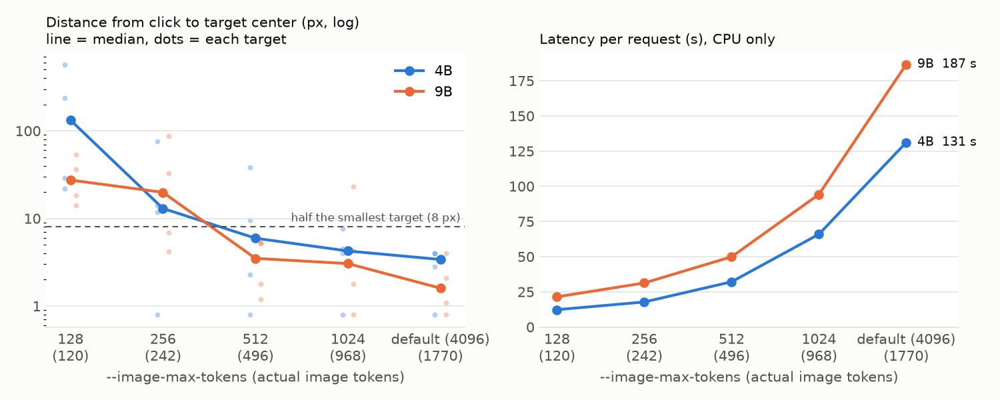

# holo-playground

Two questions about [Holo 3.1](https://huggingface.co/collections/Hcompany/holo31), H Company's computer-use model, run locally on a laptop CPU with [llama.cpp](https://github.com/ggml-org/llama.cpp):

1. **Grounding:** how much screen resolution does the model need to click the right element, and what does it cost?
2. **Agent:** can it complete a web task end to end, step after step, and where does the time go?

The agent is written from scratch (Playwright, Pydantic, any OpenAI-compatible endpoint, no agent framework), so that every token sent to the model and every millisecond spent is visible and measured.

## At a glance

- **9B at 512 image tokens is the sweet spot for grounding:** 4/4 targets hit in 50 s per click, against 187 s at full resolution. Below ~512 tokens, accuracy does not degrade gracefully: it collapses.
- **The agent completes its first task:** "open the Holo 3.1 9B model page and give its license" succeeded in both trials, in 4 steps and ~8.7 minutes each, following the same path both times.
- **On a CPU, memory management is the cost driver.** Re-using the KV cache keeps a step at 80–100 s. Each time the oldest screenshot is dropped from the history, the cache breaks and the step costs ~190–205 s.

## Part 1 — Grounding: accuracy vs. image budget

The sweep varies the number of tokens the image is encoded into (`--image-max-tokens`) and measures click accuracy and latency for each budget, on the 4B and the 9B.



### Key findings

- **Image tokens drive the latency.** Encoding the image and processing its tokens before the   first output token (the *prefill*) accounts for 80–98 % of each request. The answer itself is   only ~16 tokens. Halving the image budget roughly halves the latency.
- **Accuracy holds down to ~512 tokens, then collapses.** At 512 tokens, the 9B is still within 4 px of the target center (median), on targets as small as 19×16 px. At 128 tokens, the 4B stops being imprecise and starts being wrong: it clicks on unrelated elements, up to 570 px from the target.
- **The 9B degrades more gracefully.** At 128 tokens it misses 3 targets out of 4, but never by more than 53 px from the target center, against 570 px for the 4B. Its larger language model seems to recover the page layout even when the image is too coarse to pinpoint a small icon.
- **Best trade-off here: 9B at 512 tokens.** It hits 4/4 targets in 50 s, faster than the 4B at 1024 tokens (66 s) for a similar or better accuracy. On this machine, a bigger model looking at a smaller image beats a smaller model looking at a bigger one.
- **Generation speed follows the weight size.** The 9B generates tokens 1.8× slower than the 4B, and its weights are 1.8× larger (5.6 vs. 3.1 GB): each new token re-reads every weight from RAM, so generation is memory-bandwidth bound. Prefill, which processes tokens in batches, is only 1.4–1.7× slower. I haven't isolated why yet.

### Results

One 1897×963 screenshot of the Hugging Face home page, 4 targets from a 94×30 px text link down to a 19×16 px heart icon. Greedy decoding (temperature 0). A *hit* is a click inside the target's bounding box.

| `--image-max-tokens` | image tokens | model | hits | median dist. to center | prefill | gen tok/s | latency |
|---|---|---|---|---|---|---|---|
| default (4096) | 1770 | 4B | 4/4 | 3.4 px | 128 s | 6.2 | 131 s |
| default (4096) | 1770 | 9B | 4/4 | 1.6 px | 182 s | 3.8 | 187 s |
| 1024 | 968 | 4B | 4/4 | 4.2 px | 63 s | 6.8 | 66 s |
| 1024 | 968 | 9B | 3/4 | 3.0 px | 90 s | 3.9 | 94 s |
| 512 | 496 | 4B | 3/4 | 5.9 px | 30 s | 7.0 | 32 s |
| 512 | 496 | 9B | 4/4 | 3.5 px | 46 s | 4.0 | 50 s |
| 256 | 242 | 4B | 2/4 | 13.0 px | 15 s | 7.0 | 18 s |
| 256 | 242 | 9B | 2/4 | 19.8 px | 27 s | 3.5 | 31 s |
| 128 | 120 | 4B | 0/4 | 132.6 px | 10 s | 7.2 | 12 s |
| 128 | 120 | 9B | 1/4 | 27.4 px | 17 s | 4.0 | 21 s |

`--image-max-tokens` is a cap: llama.cpp shrinks the image until it fits, then rounds each side down to a multiple of 32 px (one token per 32×32 px), so the *image tokens* actually produced land 3–6 % under it. Without the flag, llama.cpp applies its own cap of 4096 tokens for Qwen-VL models: this screenshot stays under it and is only rounded to 1888×960 px, i.e. 1770 tokens. Every prompt also carries ~186 text tokens (instruction and JSON schema), the same for every budget.

The raw data is in [results/](results/): one `results.csv` per model, plus server logs and screenshots annotated with every click (`clicks-<budget>.png`).

### Caveats

- **4 targets on 1 screenshot is a smoke test, not a benchmark.** Each target is 25 % of the hit rate. Some results are likely noise: the 9B misses the heart icon at 1024 tokens but hits it at 512, and two misses are within 1.5 px of the box edge (0.04 and 1.3 px). That's why the median distance to the target center is reported next to the hit count.
- **Prefill time grows faster than the token count.** Each token attends to all the previous ones, so the cost per token rises with the prompt length: the 4B processes ~31 tokens/s at 128 tokens but ~16 at full resolution. That's why the table reports prefill in seconds, not tokens/s, which aren't comparable across budgets.
- **The 4B default-budget timings drifted** from 18.7 to 12.3 prefill tok/s over 4 requests, probably CPU throttling. Treat its 131 s as pessimistic.
- **The published screenshot was edited after the runs**: the browser bookmarks, profile icons and Hugging Face username are painted over. No target is affected, but re-running on this image may not reproduce the exact clicks.
- llama.cpp warns that Qwen-VL-based models (which Holo is) need at least 1024 image tokens for reliable grounding. The results above show where that floor actually starts to bite.

### Next steps (grounding)

- 20–30 targets over several screenshots, so that hit rates mean something.
- Accuracy as a function of target size, the likely real driver.
- A 768-token budget, between the 9B's last clean result (512) and the 4B's (1024).

## Part 2 — A web agent from scratch

### How it works

```
          ┌──────────────── one step ────────────────┐
task ──►  screenshot ──► Holo 3.1 9B ──► JSON step ──► Playwright ──► next screenshot ...
          (1280×800,      (llama-server,  {note, thought,   (click / type /
           476 tokens)     CPU)           tool_call}        scroll / answer)
```

- [`browser.py`](src/holo_playground/agent/browser.py) drives Chromium and reports what each action did ("url changed to …", "page unchanged"), with guardrails: allowed domains only, no typing without a focused field.
- [`actions.py`](src/holo_playground/agent/actions.py) defines the step format from [H Company's structured-output guide](https://hub.hcompany.ai/models-api/build-an-agent/structured-outputs) as Pydantic models. The server turns their JSON schema into a grammar, so every step parses.
- [`memory.py`](src/holo_playground/agent/memory.py) builds the conversation: the task, then each step and its result. Only the last 3 screenshots are kept (`keep_last=3`, as H recommends); older ones become `[screenshot evicted]`, while the model's notes stay.
- [`policy.py`](src/holo_playground/agent/policy.py) asks the model for the next step; [`run.py`](src/holo_playground/agent/run.py) runs the loop, writes a [JSONL trace](#what-every-trial-records) and checks the answer ([`evaluate.py`](src/holo_playground/agent/evaluate.py)).
- The model server is a separate process. The agent only knows an OpenAI-compatible URL, so switching to H's hosted API is a command-line flag, not a code change.

### First task: find a model's license

Start on `huggingface.co/Hcompany`, instruction: *"Open the page of the Holo 3.1 9B model and give its license."* Holo 3.1 9B, 512 image tokens, temperature 0.8.


Both trials took the same four steps and answered `apache-2.0` (once as a full sentence), which matches the page. The orange rings are where the model clicked.


| step | action | tokens computed | tokens reused from cache | prefill | generation | total |
|---|---|---|---|---|---|---|
| 1 | click the search bar | 1,511 | 0 | 107 s | 37 s | 145 s |
| 2 | type "Holo 3.1 9B" | 642 | 1,507 | 50 s | 31 s | 80 s |
| 3 | click the result | 617 | 2,145 | 52 s | 41 s | 94 s |
| 4 | answer "apache-2.0" | 1,966 | 995 | 153 s | 35 s | 189 s |

Trial of 2026-11-23 16:12 ([trace](results/agent/20261123-161259-holo-license/trace.jsonl)). The other trial's steps took 125, 76, 101 and 205 s.

### What the numbers say

- **The KV cache works across steps, images included.** From step 2 on, the server reuses everything it has already processed and computes only the new part (~620 tokens: the last step, its result and the new screenshot). A step then costs 80–100 s instead of ~145 s. llama-server had not reused a partially matching multimodal prompt in an earlier test, so this had to be measured, not assumed.
- **Dropping a screenshot breaks the cache.** At step 4 the oldest screenshot is replaced by text. The prompt now differs right after the task, so the server recomputes the three remaining screenshots and everything between them: 1,966 tokens, 153 s of prefill. With `keep_last=3`, *every* step from the 4th on pays this price. On a GPU the recompute is cheap, which is presumably why H's default is fine there. On a CPU, the eviction policy becomes a design decision: dropping screenshots in batches (for example, keep up to 5, then go back to 2) would break the cache once every three steps instead of every step.
- **The cache always stops a few tokens short, and the chat template says why.** Each step reuses the previous prompt minus 4 tokens, never the step the model just wrote. Holo's chat template asks for an answer with an empty `<think></think>` block, but rewrites past answers without it. The text differs from that point, so the ~125 tokens of the previous step are recomputed every time. It costs a few seconds per step: not worth a custom template today, but it is the kind of detail only `prompt_n` / `cache_n` make visible.
- **Generation is the other half: ~35 s per step.** A step is ~125 tokens at ~3.5 tokens/s. The `note` field is about half of them and often re-describes the page instead of recording task facts: the next lever on latency, through the prompt.
- **The request overhead is negligible.** Wall time equals prefill + generation within a second: HTTP, image encoding to base64 and JSON parsing don't matter; image encoding by the vision encoder is counted in the prefill.

### What every trial records

`runs/<stamp>/<task>/trace.jsonl` gets one line per step, written as soon as the step ends, so a crash or Ctrl-C keeps everything up to that point. Each line has the thought, note and action, the click in pixels, the URL before and after, tokens computed and reused, prefill and generation times, and the screenshot file. A final line holds the answer and two separate verdicts:

- `success`: the answer matches the task's check (a regular expression on the lowercased answer, so "Apache 2.0" and "The license is apache-2.0" both pass). Running out of steps counts as a failure (`false`). Only an infrastructure crash gives `null`, so that it is neither counted as an agent failure nor silently dropped.
- `reached_page`: whether the agent actually opened the page. A correct answer without it would be a guess, or something the model already knew.

### Caveats

- **One task, two trials.** This shows the loop works and where the time goes, not a success rate. The trace format was added after the first trial: only the second one is in `results/`.
- **The first-step prefill varies** from 92 to 107 s with the same 1,511 tokens, depending on free RAM. Single-run timings are indicative.
- **A string check cannot read negation:** "MIT, not apache-2.0" would pass. A test documents this limit; an LLM judge would be the next step.
- **Thinking is disabled** (it adds ~50 s per step on this CPU), and the task runs on a live website that can change between trials.

### Next steps

- A task file and `--trials`, then a campaign of 5 tasks × 3 trials for a first success rate and a failure classification (wrong click vs. wrong plan, from the click positions and the thoughts).
- Batched screenshot eviction, measured against `keep_last=3`.
- The same tasks through H's hosted API (`--base-url`), to separate the model's ability from this laptop's latency.
- Tracing in [Langfuse](https://langfuse.com) on top of the JSONL trace.

## Setup

Hardware: Intel i7-1165G7 (4 cores), CPU only, WSL2 with 10 GB of RAM.
Software: llama.cpp build 12480, Python 3.13, [uv](https://docs.astral.sh/uv/).

1. Clone the repository (every command below runs from its root):

   ```bash
   git clone https://github.com/noech373/holo-playground.git
   cd holo-playground
   ```

2. Build [llama.cpp](https://github.com/ggml-org/llama.cpp) in `~/llama.cpp` (`llama-server` is expected in `~/llama.cpp/build/bin/`).
3. Download the quantized models (Q4_K_M weights + Q8_0 vision projector):

   ```bash
   uvx --from huggingface_hub hf download mradermacher/Holo-3.1-4B-GGUF \
     Holo-3.1-4B.Q4_K_M.gguf Holo-3.1-4B.mmproj-Q8_0.gguf --local-dir ~/models/holo-3.1-4b
   uvx --from huggingface_hub hf download mradermacher/Holo-3.1-9B-GGUF \
     Holo-3.1-9B.Q4_K_M.gguf Holo-3.1-9B.mmproj-Q8_0.gguf --local-dir ~/models/holo-3.1-9b
   ```

4. Install the project and the browser: `uv sync`, then `uv run playwright install chromium`.

## Usage

**Run a sweep.** It starts and stops its own `llama-server` for each budget:

```bash
uv run holo-sweep screenshots/hf_home.png screenshots/hf_home.json --model 9b
```

Targets are a JSON list of `{name, element, box: [x0, y0, x1, y1]}`, where `element` is the natural-language instruction given to the model and `box` the ground truth in pixels.

**Rebuild the table and chart** from one or more sweeps:

```bash
uv run holo-report results/*/results.csv --screenshot screenshots/hf_home.png
```

**Run the agent.** Start the model server in one terminal, then the agent in another:

```bash
uv run holo-serve --model 9b --budget 512   # llama-server with the KV cache on, until Ctrl-C
uv run holo-agent                           # one trial; prints each step, writes runs/<stamp>/<task>/
uv run holo-agent-report runs/<stamp>/<task>/trace.jsonl   # step table + docs/agent-*.png
```

`holo-agent --base-url … --model … --api-key …` points it at any other OpenAI-compatible endpoint.

**Locate a single element** with a `llama-server` already running on port 8080:

```bash
uv run holo-locate screenshots/hf_home.png "the 'Models' link in the top navigation bar"
```

## How the sweep works

- [`locate.py`](src/holo_playground/locate.py) sends the screenshot and the [grounding prompt documented by H Company](https://hub.hcompany.ai/models-api/element-localization.md) through llama-server's OpenAI-compatible API. A JSON schema constrains decoding, so the model can only output `{"x": int, "y": int}`. Holo answers in a normalized 0–1000 space, which is scaled back to pixels.
- [`sweep.py`](src/holo_playground/sweep.py) restarts the server for each `--image-max-tokens` value, with `--no-cache-prompt` so that every request re-processes the full image and timings stay comparable. It scores each click against its box and records llama-server's per-request timings (prefill and generation token counts and durations).
- [`report.py`](src/holo_playground/report.py) aggregates the CSVs into the table and chart above.
