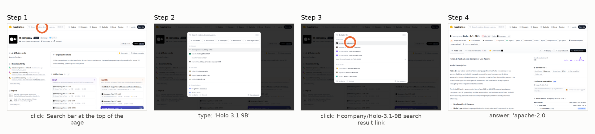
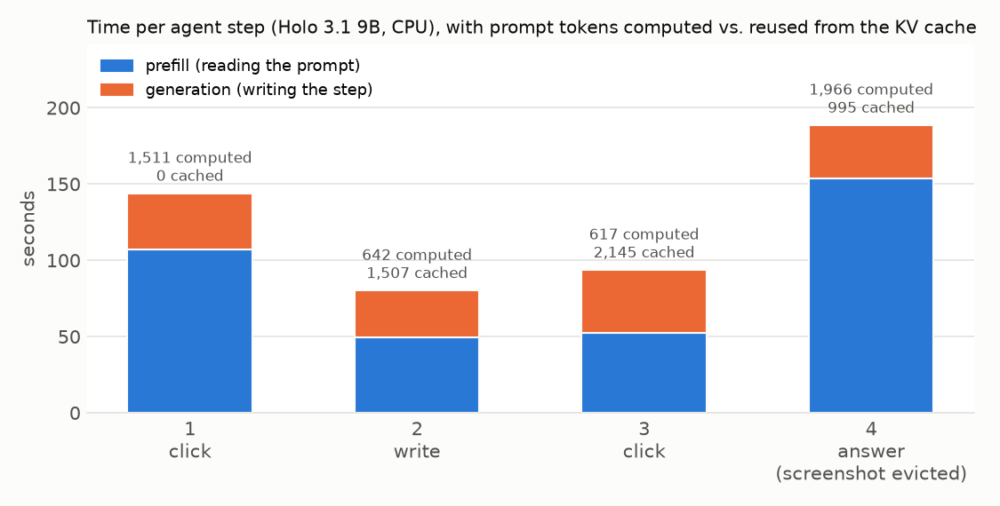

# Web agent: detailed analysis

[Back to the README](../README.md), which gives the hardware, the setup and the commands.

## How it works

```
          ┌──────────────── one step ────────────────┐
task ──►  screenshot ──► Holo 3.1 9B ──► JSON step ──► Playwright ──► next screenshot ...
          (1280×800,      (llama-server,  {note, thought,   (click / type /
           476 tokens)     CPU)           tool_call}        scroll / answer)
```

- [`browser.py`](../src/holo_playground/agent/browser.py) drives Chromium and reports what each action did ("url changed to …", "page unchanged"), with guardrails: allowed domains only, no typing without a focused field.
- [`actions.py`](../src/holo_playground/agent/actions.py) defines the step format from [H Company's structured-output guide](https://hub.hcompany.ai/models-api/build-an-agent/structured-outputs) as Pydantic models. The server turns their JSON schema into a grammar, so every complete step parses; a step cut by `max_tokens` is recorded as `truncated`.
- [`memory.py`](../src/holo_playground/agent/memory.py) builds the conversation: the task, then each step and its result. Only the last 3 screenshots are kept (`keep_last=3`, as H recommends); older ones become `[screenshot evicted]`, while the model's notes stay.
- [`policy.py`](../src/holo_playground/agent/policy.py) asks the model for the next step; [`run.py`](../src/holo_playground/agent/run.py) runs the loop, writes a [JSONL trace](#what-every-trial-records) and checks the answer ([`evaluate.py`](../src/holo_playground/agent/evaluate.py)).
- Tasks are data: [`tasks/hf.json`](../tasks/hf.json) gives each one a start URL, an instruction, the allowed domains and an answer check. [`tasks.py`](../src/holo_playground/agent/tasks.py) validates the file before the first trial, so a typo fails in a second, not after a night of runs.
- The model server is a separate process. The agent only knows an OpenAI-compatible URL. The one field it sends beyond the OpenAI API, `chat_template_kwargs: {"enable_thinking": false}`, is accepted by both llama-server and [H's API](#same-task-on-hs-api).

## First task: find a model's license

Start on `huggingface.co/Hcompany`, instruction: *"Open the page of the Holo 3.1 9B model and give its license."* Holo 3.1 9B, 512 image tokens, temperature 0.8.



Both trials took the same four steps and answered `apache-2.0` (once as a full sentence), which matches the page. The orange rings are where the model clicked.



| step | action | tokens computed | tokens reused from cache | prefill | generation | total |
|---|---|---|---|---|---|---|
| 1 | click the search bar | 1,511 | 0 | 107 s | 37 s | 145 s |
| 2 | type "Holo 3.1 9B" | 642 | 1,507 | 50 s | 31 s | 80 s |
| 3 | click the result | 617 | 2,145 | 52 s | 41 s | 94 s |
| 4 | answer "apache-2.0" | 1,966 | 995 | 153 s | 35 s | 189 s |

Trial of 2026-11-23 16:12 ([trace](../results/agent/20261123-161259-holo-license/trace.jsonl)). The other trial's steps took 125, 76, 101 and 205 s.

## What the numbers say

- **The KV cache works across steps, images included.** From step 2 on, the server reuses everything it has already processed and computes only the new part (~620 tokens: the last step, its result and the new screenshot). A step then costs 80–100 s instead of ~145 s.
- **Dropping a screenshot breaks the cache.** At step 4 the oldest screenshot is replaced by text. The prompt now differs right after the task, so the server recomputes the three remaining screenshots and everything between them: 1,966 tokens, 153 s of prefill. With `keep_last=3`, *every* step from the 4th on pays this price. On a GPU the recompute is cheap, which is presumably why H's default is fine there. On a CPU, the eviction policy becomes a design decision: dropping screenshots in batches (for example, keep up to 5, then go back to 2) would break the cache once every three steps instead of every step.
- **The cache always stops a few tokens short, and the chat template says why.** Each step reuses the previous prompt minus 4 tokens, never the step the model just wrote. Holo's chat template asks for an answer with an empty `<think></think>` block, but rewrites past answers without it. The text differs from that point, so the ~125 tokens of the previous step are recomputed every time. It costs a few seconds per step: not worth a custom template today, but it is the kind of detail only `prompt_n` / `cache_n` make visible.
- **Generation is the other half: ~35 s per step.** A step is ~125 tokens at ~3.5 tokens/s. The `note` field is about half of them and often re-describes the page instead of recording task facts: the next lever on latency, through the prompt.
- **The request overhead is negligible.** Wall time equals prefill + generation within a second: the HTTP round trip, packing the screenshot into base64 and parsing the JSON don't matter. The vision encoder's work on the screenshot is part of the prefill.

## Same task on H's API

Same agent, same system prompt, same task (temperature 0.8, last 3 screenshots), with `--base-url` pointing to H's API and `holo3-1-35b-a3b`, 3 trials on 2026-11-27 ([traces](../results/agent/20261127-091732-holo-license-hosted/)), with the default cap of 300 tokens per step. All three answered with the right license and opened the model page (`success: true`, `reached_page: true`).

| trial | steps | path | end to end | waiting for the model |
|---|---|---|---|---|
| 1 | 4 | search bar, type, result, answer | 23 s | 10 s |
| 2 | 4 | search bar, type, result, answer | 16 s | 7 s |
| 3 | 6 | scroll twice, "View 39 models", scroll, model link, answer | 47 s | 36 s |
| *local 9B, for scale* | *4* | *search bar, type, result, answer* | *520 s* | *508 s* |

- **This is not a model comparison:** a 35B-A3B on H's hardware against a 9B on a laptop CPU, on a handful of trials. The image budget also differs: capped at 512 tokens locally, left to the API's default here.
- **The path varies between trials.** Trial 3 never used the search bar, and still got there.
- **The browser becomes a large share of the time.** 8–13 s per trial are spent outside model calls (browser launch, page loads, fixed pauses between actions): about half of trials 1 and 2. With fast inference, the environment is worth optimizing too.
- **One request took 25 s** (trial 3, step 3), against 2–4 s for the others. It was the 11th request in about 40 s, so most likely the free tier's limit of 10 requests per minute: the OpenAI client retries silently, and `wall_s` includes the wait. The two later runs below record the client's retries per step, and confirm it: their only slow steps (15.5 and 26.5 s) are the two with `retries: 1`.
- **A false negative from the evaluator.** The first hosted trial, on 2026-11-26 ([trace](../results/agent/20261126-174604-holo-license-hosted/trial-1/trace.jsonl)), was scored a failure: the agent answered "Apache License 2.0" and the pattern required "2.0" right after "apache". The agent was right, the check was wrong. The pattern was fixed before the three trials above (the run's [`tasks.json`](../results/agent/20261126-174604-holo-license-hosted/tasks.json) keeps the old one), and that answer is now a test case. The old trace keeps its original verdict.

Two more runs of 3 trials followed the same morning, with the retries recorded:

- **The 300-token cap can cut a step** ([run](../results/agent/20261127-104559-holo-license-hosted/)). Trial 1 stopped at its second step, `truncated` and scored a failure: the hosted model writes longer thoughts and notes than the local 9B (85 words of thought at the step before) despite the "one short sentence" rule, and the cap was sized for the 9B. Trials 2 and 3 succeeded. This run predates `raw_output`, so the cut text was not kept.
- **With `--max-tokens 600`, 3/3** ([run](../results/agent/20261127-105349-holo-license-hosted/)), 4 steps each, 15–40 s. This is the command the README gives.

## What every trial records

`runs/<stamp>/<task>/trial-<n>/trace.jsonl` gets one line per step, written as soon as the step ends, so a crash or Ctrl-C keeps everything up to that point. (The runs quoted on this page were copied to [`results/agent/`](../results/agent/), whose README explains their layouts.) Each line has the thought, note and action, the click in pixels, the URL before and after, tokens computed and reused, prefill and generation times, the wall time, the retries of the API client, and the screenshot file. Token counts and prefill/generation times come from llama-server: they are `null` on H's API, where `holo-agent-report` shows the wall time of each model call instead. A final line holds the answer and two separate verdicts:

- `success`: the answer matches the task's check (a regular expression on the lowercased answer, so "Apache 2.0", "Apache License 2.0" and "The license is apache-2.0" all pass). Running out of steps, or an output that does not parse as a step, counts as a failure (`false`). Only an infrastructure crash gives `null`, so that it is neither counted as an agent failure nor silently dropped. When the output was cut or did not parse, the end line keeps it in `raw_output`, to see what went wrong.
- `reached_page`: whether the agent actually opened the page. A correct answer without it would be a guess, or something the model already knew.

## Caveats

- **One task, a handful of trials** (two locally, nine on H's API over three runs, plus the mis-scored one). This shows the loop works and where the time goes, not a success rate.
- **Only the second local trial has a trace**, since the format was added after the first. That trace predates the automatic verdict (`success: null`, no `reached_page`); re-judged with the current check, it passes and reaches the page.
- **The first-step prefill varies** from 92 to 107 s with the same 1,511 tokens, depending on free RAM. Single-run timings are indicative.
- **A string check cannot read negation:** "MIT, not apache-2.0" would pass. A test documents this limit; an LLM judge would be the next step.
- **Thinking is disabled**, by `holo-serve` (`--reasoning-budget 0`) and by every agent request (`enable_thinking: false`): it adds ~50 s per step on this CPU.
- **The task runs on a live website** that can change between trials.
